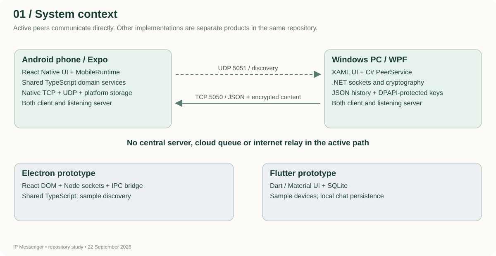
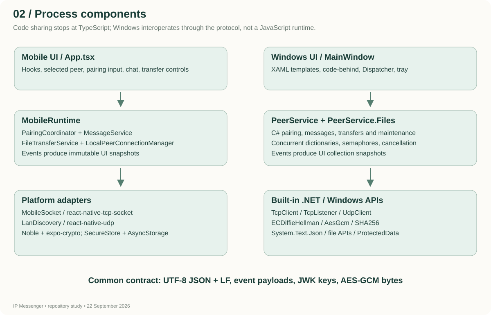
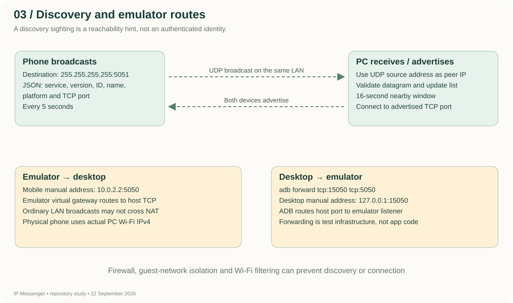
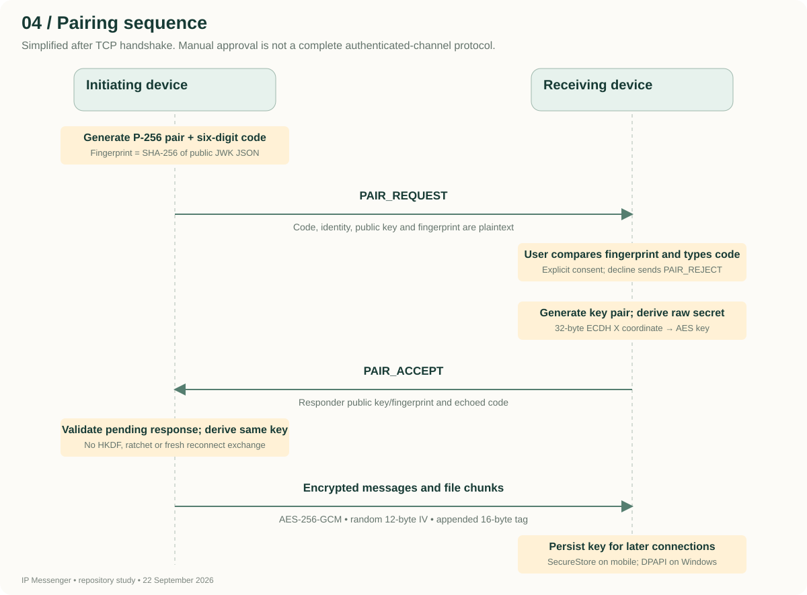
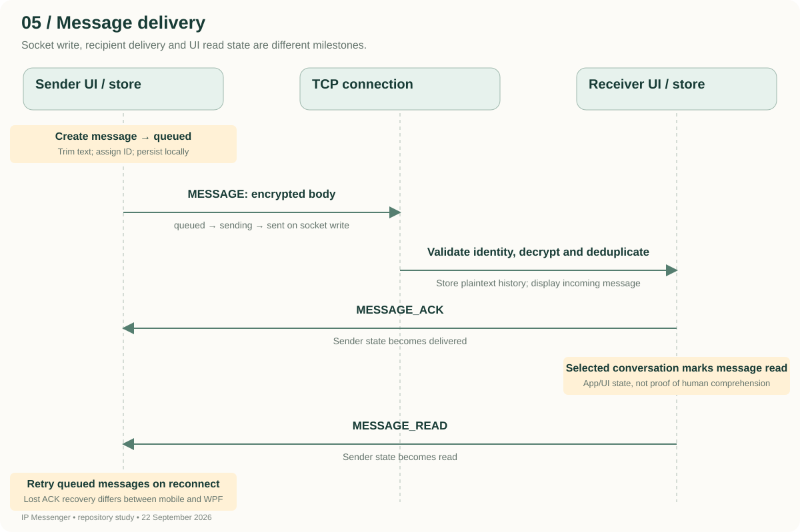
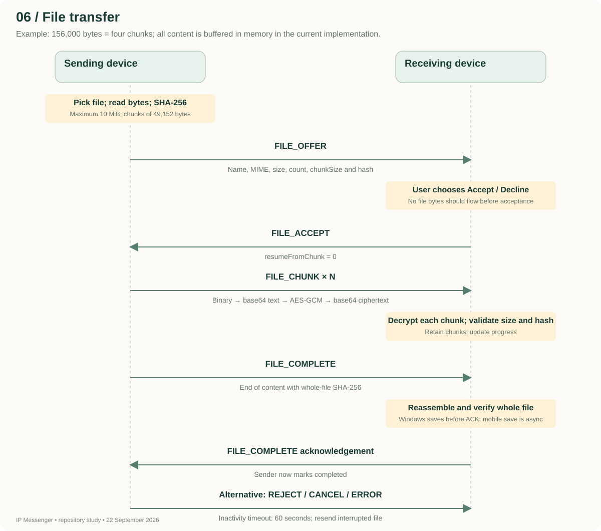
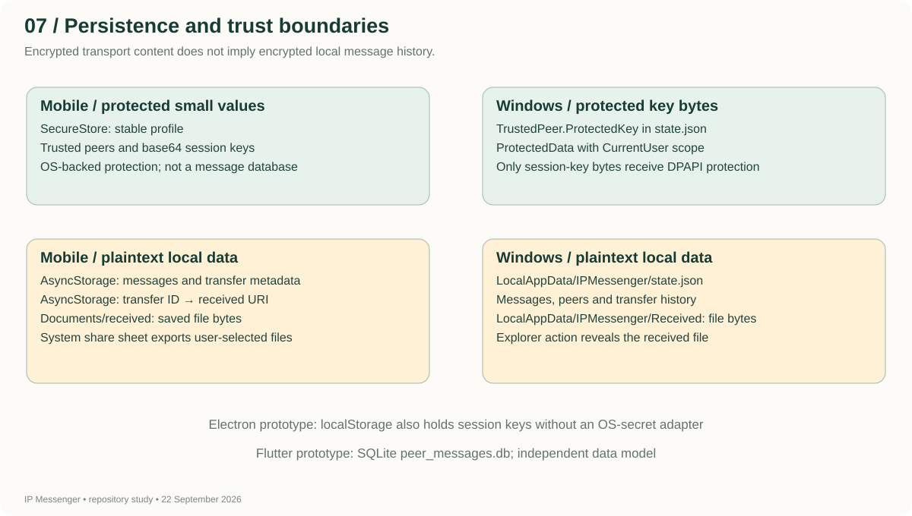
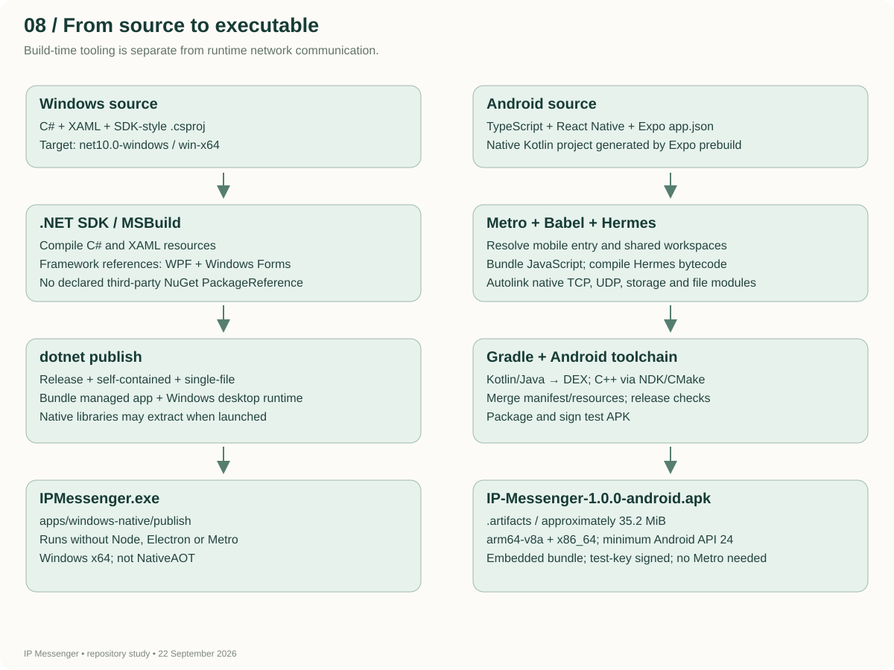

# IP Messenger: architecture and implementation study

Repository study dated **22 September 2026**. Implementation evidence comes from the source and manifests in this workspace. Device-test results below refer to the work performed on **19 September 2026**, not a new physical-phone test. Library versions are locally resolved versions, not claims about the latest releases.

This is a local-network messaging application. Each active device is both a client and a server: it advertises its presence, listens for connections, connects to another peer, asks the user to approve pairing, and exchanges message bodies and file chunks encrypted with a shared key. No cloud account, central message server, REST API, Firebase service, WebSocket server, or internet relay is implemented in the active mobile/WPF path.

“Why” in the library descriptions means the role a library serves in the inspected implementation. Where an original design decision is not recorded, the explanation is an engineering interpretation rather than a claim about its author's intent.

## 1. What is actually in this repository

| Implementation | Source | Technology | Current role |
|---|---|---|---|
| Android mobile app | `apps/mobile` | TypeScript, React Native, Expo, Android native modules | Active application; standalone test APK built and emulator-tested |
| Native Windows desktop | `apps/windows-native` | C#, .NET 10, WPF/XAML, Windows Forms tray integration | Active desktop; pairing, chat and files verified against the emulator |
| Electron desktop | `apps/desktop` | React DOM, TypeScript, Electron, Node sockets, Vite | Separate prototype; discovery still comes from sample data |
| Flutter application | Root `lib`, `pubspec.yaml`, root platform folders | Dart, Flutter, SQLite | Separate prototype; sample devices and local message storage, not the Expo APK |
| Shared TypeScript packages | `packages/*` | Models, protocol definitions, networking and domain services | Imported directly by mobile and Electron; exercised by Node tests |

The WPF application does **not** execute or import the TypeScript packages. It implements the same wire format independently in C#. Compatibility is established through protocol agreement and cross-language tests. The root `windows/` directory belongs to Flutter; the working WPF executable comes from `apps/windows-native/`.



The two desktop products also produce different artifacts. `apps/windows-native/publish/IPMessenger.exe` is the self-contained WPF executable. `apps/desktop/release/IPMessenger-Setup.exe` is the Electron NSIS installer. A familiar product name does not establish which implementation a shortcut launches: inspect its target path.

## 2. Stack by layer

| Layer | Android application | Native Windows application |
|---|---|---|
| UI language | TypeScript with JSX | XAML markup and C# code-behind |
| UI framework | React 19.1.0 / React Native 0.81.5 | Windows Presentation Foundation |
| Application runtime | Expo 54.0.37; Hermes JavaScript engine | .NET 10 Windows desktop runtime |
| UI composition | React hooks, React Native controls and StyleSheet | Grid, DockPanel, StackPanel, ListBox, ItemsControl, templates and events |
| Coordination | `MobileRuntime` | `PeerService` and `MainWindow` |
| TCP | `react-native-tcp-socket` through `MobileSocket` | `TcpListener`, `TcpClient`, `NetworkStream` |
| Discovery | `react-native-udp` | `UdpClient` |
| Message format | JSON encoded as UTF-8 and terminated by LF | Same; `System.Text.Json` with web/camelCase defaults |
| Cryptography | Noble P-256/AES-GCM/SHA-256 plus Expo native random bytes | .NET ECDH, AES-GCM, SHA-256 and native secure random APIs |
| Protected small values | Expo SecureStore | Windows DPAPI for session keys |
| History | AsyncStorage JSON values | JSON state file |
| Received file storage | App documents directory; native share sheet for export | LocalAppData `Received` directory; Explorer reveal action |
| Build tools | Node/npm, Babel, Metro, Gradle, Kotlin, Android SDK/NDK, CMake | .NET SDK, MSBuild, C# compiler, XAML compilation and publish |

React Native renders native platform UI rather than an Electron browser window. The Android project enables React Native's New Architecture and Hermes; native dependencies still determine their own interoperability details. WPF is Windows-only even though .NET supports other platforms. These framework distinctions are supported by the [React Native architecture overview](https://reactnative.dev/architecture/landing-page) and [Microsoft's WPF overview](https://learn.microsoft.com/en-us/dotnet/desktop/wpf/overview/).

## 3. Source map and responsibilities

| File or folder | Responsibility and entry points |
|---|---|
| `apps/mobile/index.js` | Calls Expo `registerRootComponent(App)`; actual mobile entry, not Expo Router |
| `apps/mobile/App.tsx` | One scrolling screen: profile rename, peers, manual address, pairing, selected chat, file actions, errors and startup retry |
| `apps/mobile/src/runtime.ts` | Creates services; starts/stops listeners; converts events to UI snapshots; heartbeat, reconnect, document picker and received-file saving |
| `apps/mobile/src/socket.ts` | Native TCP adapter; streaming UTF-8 decoder; incoming server on `0.0.0.0:5050` |
| `apps/mobile/src/discovery.ts` | UDP discovery JSON, broadcasts, peer cache, last-seen expiry |
| `apps/mobile/src/crypto.ts` | Noble crypto implementation of the shared `CryptoProvider` interface |
| `apps/mobile/src/security.ts` | SecureStore adapter and pairing service construction |
| `apps/mobile/src/identity.ts` | Stable stored profile; overrides platform detection with React Native `Platform.OS` |
| `packages/protocol/src/index.ts` | Event union, runtime envelope parser, payload interfaces |
| `packages/networking/src/index.ts` | Socket interface, connection manager, newline parser, handshake, ping/pong, retry policy |
| `packages/models/src/index.ts` | Message, file, device and conversation data shapes; state unions |
| `packages/shared/src/index.ts` | Common constants, profile/settings/storage interfaces and package exports |
| `packages/shared/src/device-profile.ts` | Load/create/save profile and rename display name |
| `packages/shared/src/security.ts` | Pairing requests, approval, trust persistence, restored sessions, CryptoSession |
| `packages/shared/src/crypto-provider.ts` | Default WebCrypto provider and injectable platform provider |
| `packages/shared/src/messaging.ts` | Local queue, encrypted sends, receive deduplication, delivery/read receipts, persisted history |
| `packages/shared/src/file-transfer.ts` | Offer/accept/reject/cancel, chunk processing, checksums, timeout and history |
| `packages/shared/src/storage-adapters.ts` | Browser localStorage and in-memory test adapter |
| `packages/shared/src/discovery.ts` | Discovery interfaces and mock service used by Electron, not live mobile discovery |
| `apps/windows-native/App.xaml.cs` | WPF startup and named mutex; duplicate launch shows an already-running message |
| `apps/windows-native/MainWindow.xaml` | Desktop layout, item templates, binding expressions and automation identifiers |
| `apps/windows-native/MainWindow.xaml.cs` | UI handlers, Dispatcher callbacks, tray notification/menu, file picker, Explorer reveal |
| `apps/windows-native/PeerService.cs` | Identity/history load, listeners, connection dictionaries, dispatch, pairing, messages and maintenance |
| `apps/windows-native/PeerService.Files.cs` | Partial class implementing file protocol, temporary in-memory chunks and disk writes |
| `apps/windows-native/PeerCrypto.cs` | P-256 JWK conversion, raw shared secret, AES-GCM layout and DPAPI wrappers |
| `apps/windows-native/PeerModels.cs` | Persisted models, transient transfer buffers, derived UI fields |
| `scripts/peer-fixture.ts` | Real Node TCP sockets adapted to shared interfaces for testing |
| `scripts/lan-test-peer.ts` | Explicit development peer on TCP 5052; auto-approves and echoes only for testing |
| `test/native-interop/Program.cs` | Console harness compiling the production C# backend without launching WPF |
| `scripts/build-mobile-apk.ps1` | Release APK build with monorepo entry-point settings and artifact copy |

The TypeScript packages expose `src/index.ts` directly through `main`, `types` and `exports`. Metro/Vite process that source; there is no separate published npm package or domain-service microservice. Root TypeScript settings use strict mode, ES2022, isolated modules and bundler resolution. TypeScript types do not replace runtime validation of hostile network input.



## 4. Startup, UI updates and shutdown

Mobile startup loads the device profile from SecureStore, constructs `MobileRuntime`, installs the mobile crypto provider, creates the connection manager and services, and registers callbacks. It restores pairing sessions, messages, transfers and received-file paths before starting the TCP listener. UDP discovery starts next; a discovery failure is reported but is allowed to leave direct TCP usable. A successful listener startup marks the UI ready. TCP/UDP native modules are checked explicitly; Expo Go does not contain them.

The UI owns selection, typed address, message draft, pairing-code input, a busy flag and startup generation. Service events update snapshots through React state. Peer rows combine live discovery, stored trusted peers and connected peers. A stored trusted device can therefore appear offline; that is not fake discovery data. Incoming pairing needs approval. Reading a selected conversation triggers read-receipt calls. All transfers appear in the mobile transfer list, whereas WPF filters transfers to the selected peer.

Mobile startup subscribes to AppState. Every ten seconds, while active, it pings connected peers and tries remembered endpoints for paired peers. An activity-generation counter avoids interpreting a ping timeout spanning background/foreground transitions as a fresh failure. Opening the document picker temporarily backgrounds the app; the runtime attempts to reconnect before offering the selected file if necessary. Endpoint memory is not persisted across restart.

Stopping mobile clears heartbeat/discovery timers, service subscriptions and sessions, closes connections and stops the server. There is no Android foreground service or push-notification wakeup mechanism, so screen-off/background operation is not a promised delivery mode. Development reloads previously left a stale listener; a full process restart resolved the observed session. This does not prove lifecycle handling is correct for every reload/device.

WPF startup acquires `Local\IPMessenger.Native`, creates `MainWindow`, initializes XAML and constructs its service. The service loads saved state, restores decryptable keys and creates listeners. UI callbacks from service events are marshalled with `Dispatcher.BeginInvoke`. Each refresh takes collection snapshots, preserves selection, binds messages/transfers and marks displayed incoming messages read when active. This is event-driven code-behind, not an MVVM implementation with a separate view-model framework.

Closing the WPF window hides it. Its Windows Forms `NotifyIcon` keeps Open and Exit available in the tray; incoming messages can trigger a balloon notification when the window is inactive. Exit cancels listeners/timers, disposes sockets and saves state before shutting down. The mutex prevents a second instance in the same Windows session; it is not a system service or a cross-user account coordinator.

## 5. Discovery: finding peers without a server

Both active implementations bind UDP port **5051** and broadcast to **255.255.255.255** approximately every **5 seconds**. The receiver uses the UDP packet's source address as the peer IP. The advertised TCP port says where to connect; UDP is not used to carry conversations or file bytes.

```json
{"service":"ip-messenger","version":1,"deviceId":"stable-peer-id","deviceName":"My Device","platform":"android","port":5050}
```

Incoming datagrams over 2,048 bytes are ignored. Implementations check service/version, identity, platform, name and port, with some validation differences. Discovery tables are limited to 100 peers. Mobile removes sightings older than 16 seconds; Windows retains peer records and computes Nearby/Offline from last-seen time. Pairing/trust is separate from being visible or connected.

Discovery packets are plaintext and unauthenticated. Anyone on a reachable network can announce a name; a peer row is not proof of identity. Broadcast ordinarily remains within the local broadcast domain and can be filtered by routers, guest Wi-Fi, client isolation, VPNs, host firewalls or phone Wi-Fi behavior. The Android manifest declares multicast-state permission, but the mobile discovery code does not explicitly acquire a multicast lock. Hardware reception remains a physical-device test item; permission declaration alone is not a proof of reception.



Manual connection bypasses discovery, not pairing or encryption. The current UI accepts IPv4 with an optional port; it is not an IPv6/DNS-name connection UI. For an emulator, `10.0.2.2:5050` points to the host desktop. Alternatively `adb forward tcp:15050 tcp:5050` lets the host desktop connect to the emulator at `127.0.0.1:15050`. These test routes do not demonstrate physical broadcast reception. A physical phone uses the PC's actual Wi-Fi address. `192.168.1.74` was observed on September 19, not verified as today's address. Android documents the forwarding tooling in its [ADB reference](https://developer.android.com/tools/adb).

The September 19 environment had Public-profile inbound IPMessenger block rules on Windows and Wi-Fi classified as Public. They were reported, not changed. Successful loopback/emulator testing does not establish that the firewall permits a physical phone. Inspect today's rules/profile before diagnosing a phone discovery failure as an app bug.

## 6. TCP connection and framing

TCP is an ordered byte stream, not a message queue. One socket read can contain part of a JSON frame or several frames. Both implementations buffer input and split on LF (`\n`). The mobile socket adapter uses streaming UTF-8 decoding, preserving characters whose bytes span reads. Windows buffers frame bytes before deserializing JSON.

```json
{"type":"MESSAGE","payload":{"messageId":"m1","senderId":"phone-id","receiverId":"pc-id","text":"","timestamp":1789800000000,"encrypted":{"iv":"base64-nonce","ciphertext":"base64-ciphertext-and-tag"}},"timestamp":1789800000000,"senderId":"phone-id"}
```

The actual frame has a trailing newline. All timestamps here are illustrative Unix milliseconds. `receiverId` can also exist on the outer TypeScript envelope, but it is not universally populated; payload-level recipient checks matter. The JSON parser validates known event types and basic envelope shape, and individual handlers validate more payload fields.

Each new connection sends `HELLO` with device identity, platform and listener port. A peer responds with `DEVICE_INFO` containing identity and appVersion. Because both endpoints run the handshake, both send HELLO and both send DEVICE_INFO. A peer becomes connected after receiving acceptable DEVICE_INFO. Expected peer ID and sender consistency checks reject mismatches, but device ID alone is an unauthenticated claim.

The TypeScript manager de-duplicates pending connects, then tries an initial connection plus up to three retries, waiting 250, 500 and 1,000 ms between attempts. Its TCP/handshake/ping defaults are 5 seconds. Windows serializes outgoing connect requests with a semaphore, uses a 5-second connect timeout and a 6-second ready timeout. It allows at most 32 currently accepted/managed connections at its incoming acceptance gate. The implementations are not identical retry engines.

Both use a nominal 2 MiB frame bound. Windows enforces this per newline-delimited byte buffer. TypeScript checks the accumulated read buffer before splitting; a very large coalesced batch can hit the bound even when each individual frame is smaller. Windows writes complete serialized frames under a per-connection semaphore to keep concurrent message/file writes from interleaving.

`PING` and `PONG` exchange a nonce. The mobile runtime invokes ping periodically; Windows responds but does not implement the same periodic application-level ping scheduler. TCP keepalive is enabled on outgoing native sockets/Windows sockets, but OS keepalive timing is not a replacement for a reliable app-level reconnect protocol.

## 7. Pairing and encryption, byte by byte



1. The initiating user presses Pair device on an established connection.
2. The initiator creates a P-256 ECDH key pair and a six-digit code, including possible leading zeros. Windows uses `RandomNumberGenerator.GetInt32`; TypeScript maps four random bytes into six digits using modulo, which has a small statistical bias.
3. The public key is serialized as a JWK JSON **string** containing `kty: EC`, `crv: P-256`, base64url X/Y coordinates, `key_ops: []` and `ext: true`.
4. SHA-256 hashes the exact UTF-8 public-key JSON string. The UI shows lowercase hexadecimal bytes separated by colons. This fingerprints the supplied serialization; reordering JWK properties changes that displayed hash even for the same curve point.
5. PAIR_REQUEST carries the code, requester identity/name, public-key string and fingerprint. The receiver checks claimed identity/code format/fingerprint consistency and asks its user to compare the fingerprint and type the displayed code.
6. On approval, the receiver generates its own P-256 pair and derives the 32-byte raw ECDH shared secret. It sends its own public key/fingerprint and the echoed code in PAIR_ACCEPT.
7. The initiator validates the pending code and response identity/fingerprint, derives the same secret, and stores the pairing. PAIR_REJECT ends a declined request.
8. The raw 32-byte shared secret is used directly as the AES-256-GCM key and persisted for reconnects. There is no HKDF, transcript-based key schedule or separate directional key in this implementation.

On Android, Noble `p256.getSharedSecret(..., false)` returns an uncompressed shared point and the provider takes bytes 1..32, its X coordinate. WebCrypto derives 256 bits. Windows uses `DeriveRawSecretAgreement`, not the default hashed `DeriveKeyMaterial` behavior. That byte-level agreement is essential to interoperability. Microsoft's [raw secret API documentation](https://learn.microsoft.com/en-us/dotnet/api/system.security.cryptography.ecdiffiehellman.deriverawsecretagreement?view=net-10.0) explains the API's role; using the raw result directly as the AES key is this project's compatibility choice.

AES-GCM generates a fresh 12-byte random IV for each message body or chunk. Plaintext text is encoded as UTF-8. Ciphertext is stored with its 16-byte authentication tag appended, matching WebCrypto/Noble. Both `iv` and combined ciphertext/tag are base64-encoded for JSON. Windows explicitly splits/appends the tag around the .NET AesGcm API. A failed authentication tag rejects the payload.

The six-digit code is an approval mechanism, **not a secret encryption key**. It is sent in cleartext with pairing. Fingerprint consistency checks detect a public-key/fingerprint mismatch but do not prove that a self-reported key belongs to the expected human. The UI compares the initiator's key; it does not implement a fully mutually authenticated transcript or an authenticated key-confirmation exchange. An active on-path attacker substituting the responder key is not addressed by a complete secure-channel protocol here. Do not describe this as Signal-equivalent security or claim an independently audited pairing design.

Security boundaries in the inspected code:

| Protected | Exposed or not implemented |
|---|---|
| Message-body content and file-chunk content after successful pairing | Discovery names, IDs, addresses, event types, timestamps and traffic sizes |
| AES-GCM integrity for the encrypted body/chunk bytes | Envelope fields, file names/sizes/hashes and control events are not supplied as GCM additional authenticated data |
| Mobile pairing values in SecureStore; Windows key bytes through DPAPI CurrentUser | Message history and received files are plaintext locally; Electron trust/session data uses browser localStorage |
| Invalid ciphertext rejection | No ratchet, regular rotation, per-connection fresh session keys or forward-secrecy scheme for retained session keys |
| Application message-ID deduplication | No authenticated sequence counter or complete replay-protection layer |
| User consent for incoming files | No content scanning, sender signatures or restricted file-type policy |

ACK/read/control frames are not cryptographically authenticated as a whole. Matching a stored peer ID to an unauthenticated transport identity is weaker than proving possession of the session key at connection establishment. These are design limitations inferred from the source, not claims that an exploit was tested during this study.

## 8. Messaging flow and delivery semantics



The sender trims text, creates an ID, stores the message locally as queued and emits a UI update. If a connection and paired session are available, it moves to sending, encrypts the text, sends a MESSAGE frame with `text: ""`, and marks it sent after the socket write completes. The receiver validates sender/recipient, decrypts, deduplicates by message ID, stores the message and sends MESSAGE_ACK. Opening/displaying the conversation triggers MESSAGE_READ.

| State | Meaning |
|---|---|
| queued | Retained on the sending device; not successfully handed to the socket yet |
| sending | An attempt is in progress |
| sent | Socket write completed; does not prove the remote UI received it |
| delivered | Receiver emitted MESSAGE_ACK |
| read | Receiver's app marked the conversation message read; not proof of human comprehension |
| failed | A model state exists, but common send failures in these implementations return to queued |

The mobile/shared service accepts nonempty text but does not impose the desktop's explicit 100,000-character cap. Windows enforces that cap and bounds message IDs. Cross-platform input limits should be aligned. Both retain message histories locally; there is no central queue when both apps are closed and no server to fetch missed messages from later.

Retries are imperfect. Windows resets its own sent/sending messages to queued when a connection closes and resets persisted sent/sending records on startup. The shared TypeScript service retries queued messages on connection events, but does not reset every sent/sending record on reconnect/restart. A lost ACK after a successful write can therefore leave a mobile message stuck as sent. The current tests cover a message queued while disconnected; they do not prove crash-safe exactly-once delivery.

Shared persistence is triggered with asynchronous calls that are not awaited by each UI emit. An ACK can happen before durable history storage. Windows writes its state synchronously through a temporary file and replacement move, but that is not a transactional database or a tested power-loss guarantee. Local deduplication and ACKs should be described as practical delivery tracking, not distributed exactly-once semantics.

## 9. File transfer: consent, chunks, validation and save



The sender picks a file, reads it into memory, checks the size, calculates whole-file SHA-256, and creates a transfer ID. A FILE_OFFER contains the original name, MIME type, byte size, sender ID, chunk count, chunk size and hash. The receiver shows an explicit Accept/Decline choice. FILE_ACCEPT currently requires `resumeFromChunk: 0`.

The fixed chunk size is **48 × 1,024 = 49,152 bytes**. Total chunks is `ceil(size / 49152)`. For the previously tested 156,000-byte file, that is four chunks: 49,152, 49,152, 49,152 and 8,544 bytes. For an empty file, there are zero chunks and completion still validates the empty-content hash.

Each binary chunk is base64-encoded, then that base64 text is encrypted as UTF-8. The ciphertext/tag is base64-encoded again for the JSON frame. A full chunk therefore becomes roughly 87,404 base64 ciphertext characters before JSON overhead, compared with 49,152 original bytes. This is easy to interoperate with but costs bandwidth and allocation compared with binary framing.

FILE_CHUNK carries ID, index, totalChunks, chunk SHA-256, an empty `chunk` string and the encrypted payload. The receiver decrypts, base64-decodes, checks expected size and hash, and retains bytes. Windows expects strictly sequential indexes. The shared receiver stores chunks in an index map and serializes file handlers per connection through a Promise queue to avoid asynchronous decrypt/reassembly races.

After all chunks, the sender sends FILE_COMPLETE with whole-file hash. The receiver checks count, full size and full hash. Windows writes the file before returning its completion acknowledgement. Mobile's shared service emits its received event and acknowledges verification, while `MobileRuntime.saveReceived` saves asynchronously; sender completion therefore does **not** guarantee that the mobile disk write has finished successfully. The mobile UI enables Save or share only after its received-path mapping is populated.

Windows saves under `%LOCALAPPDATA%\IPMessenger\Received`, prefixes a generated GUID and sanitizes filename characters. Mobile saves under its documents `received/` directory, filters names to safe characters, limits them to 100 characters and prefixes a timestamp. File-system limits, very long desktop names and storage exhaustion still need explicit tests.

Transfers are bounded to **10,485,760 bytes (10 MiB, labelled 10 MB in the UI)** and time out after 60 seconds without activity. Shared/mobile permits four incoming in-memory offers; Windows rejects new incoming offers when four active transfers already exist, including outgoing entries. Neither UI implements true byte-offset resume. A shared `resume()` method reoffers matching source bytes from chunk zero; desktop rejects duplicate transfer IDs, so sending a new offer is the interoperable retry path.

FILE_REJECT, FILE_CANCEL and FILE_ERROR stop activity. Shared rejection becomes `cancelled`; WPF has an additional `rejected` display state. Disconnect/interruption requires selecting and sending the original file again. Both sides retain full file data/chunks in memory, sometimes with base64 and reconstructed copies. Four 10 MiB transfers can consume substantially more than 40 MiB of process memory. This is not a streaming large-file implementation.

## 10. Protocol event catalogue

All network events are JSON envelopes. The discovery datagram is a separate unframed format. The following lists every event declared in `packages/protocol/src/index.ts`.

| Event | Payload fields / role | Active-path status |
|---|---|---|
| HELLO | deviceId, deviceName, platform, port | Both peers initiate handshake |
| DEVICE_INFO | deviceId, deviceName, platform, appVersion | Completes identity exchange |
| PAIR_REQUEST | pairingCode, requesterId, requesterName, publicKey, fingerprint | User approval request |
| PAIR_ACCEPT | pairingCode, responderId, responderName, publicKey, fingerprint | Key agreement response |
| PAIR_REJECT | reason | Decline/failure |
| MESSAGE | messageId, senderId, receiverId, text, timestamp, encrypted | Body encryption; text empty in secure mode |
| MESSAGE_ACK | messageId, receiverId, deliveredAt | Delivery receipt |
| MESSAGE_READ | messageId, readerId, readAt | App-level read receipt |
| TYPING_START / TYPING_STOP | No implemented active UI flow | Declared; WPF ignores; no promised typing indicator |
| FILE_OFFER | fileId, name, size, mimeType, senderId, totalChunks, chunkSize, sha256 | Explicit consent and bounds |
| FILE_ACCEPT | fileId, receiverId, resumeFromChunk | Only zero-offset transfer supported |
| FILE_REJECT | fileId, reason | Declines offer |
| FILE_START | No payload interface / active send path | Declared but not implemented; WPF does not handle it |
| FILE_CHUNK | fileId, chunkIndex, chunk, totalChunks, sha256, encrypted | Encrypted chunk content |
| FILE_COMPLETE | fileId, sha256 | End-of-data and reverse verification acknowledgement |
| FILE_CANCEL / FILE_ERROR | fileId, reason | Cancellation/error |
| PING / PONG | nonce | Liveness/response matching |
| DISCONNECT | deviceId, reason in interface | WPF closes socket; not a universal shared-manager disconnect flow |

Discovery has an explicit `version: 1`; the TCP envelope has no protocol-version negotiation field. App versions are currently inconsistent: shared `APP_VERSION` is `0.1.0`, package/app manifests are `1.0.0`, and WPF DEVICE_INFO sends `1.1.0`. Version negotiation and capability flags would prevent ambiguous future interoperability.

## 11. Storage and data models



| Store | Key/path | What is stored |
|---|---|---|
| Mobile SecureStore | `ip_messenger_device_profile` | deviceId, displayName, platform, appVersion, createdAt |
| Mobile SecureStore | `ip_messenger_trusted_devices` | Array of peer ID/name, fingerprint, public key, pairedAt and base64 sessionKey |
| Mobile AsyncStorage | `ip_messenger_messages` | Message IDs, sender/receiver, plaintext text, timestamps, states |
| Mobile AsyncStorage | `ip_messenger_file_transfers` | Offer metadata, hash, count/progress and state; interrupted entries reload as failed |
| Mobile AsyncStorage | `mobile_received_files` | Transfer ID to saved local URI |
| Mobile documents | `received/` | Plaintext received file bytes |
| Windows JSON | `%LOCALAPPDATA%\IPMessenger\state.json` | DesktopState identity, peers, trust, messages and transfer history |
| Windows DPAPI | `TrustedPeer.ProtectedKey` inside JSON | Account-protected shared key; not whole-file encryption |
| Windows files | `%LOCALAPPDATA%\IPMessenger\Received\...` | Plaintext received bytes |
| Electron localStorage | Shared storage keys | Profile/history/trust, including base64 keys without an OS-secret adapter |
| Flutter SQLite | `peer_messages.db`, table `messages` | Local prototype message records |

SecureStore uses platform-backed secure storage, but large values and platform persistence/backup behavior need care; storing the entire trust list as one JSON value is a scaling consideration. Its behavior is documented by [Expo SecureStore](https://docs.expo.dev/versions/v54.0.0/sdk/securestore/). Base64 is encoding, not encryption. DPAPI CurrentUser binds decryption to the Windows account context; moving state to another account may require re-pairing.

Windows transient fields such as source bytes, chunk maps, connection IDs and UI derived labels are excluded from JSON. It uses concurrent dictionaries for collections, a lock around serialization/file replacement, and semaphores for outgoing connection and queue serialization. These mechanisms do not make every mutable model property transactional. No SQLite or ORM is used by WPF or the active mobile UI at the application layer.

MessageModel fields are `id`, `senderId`, `receiverId`, `text`, `timestamp`, `state`. FileTransferModel fields include IDs, name, MIME, size, total/transferred chunks, hash, state and optional error. WPF adds Incoming, SavedPath and other local fields. ConversationModel and AppSettings types exist in shared source, but their declarations alone do not mean all unread-count, notification, incoming-connection or transfer settings are implemented in the active UI.

## 12. Every declared mobile library and why it is present

Versions below are the installed mobile-scope versions inspected for this study. See `declared-dependencies.md` for the original ranges and exact resolution paths in `dependencies.json`.

| Library | Version | Role, reason and usage evidence |
|---|---|---|
| `react` | 19.1.0 | Hooks and component state in App.tsx; produces declarative UI from runtime snapshots |
| `react-native` | 0.81.5 | Native controls, AppState, Platform, NativeModules and StyleSheet; Android app UI/runtime integration |
| `expo` | 54.0.37 | Root registration, native-module environment, app configuration, prebuild/CLI and SDK integration |
| `react-native-tcp-socket` | 6.4.3 | Real TCP client/server sockets; required because browser-style fetch cannot implement this raw TCP protocol |
| `react-native-udp` | 4.1.7 | UDP sockets and setBroadcast for local discovery |
| `@noble/curves` | 1.9.7 | P-256 key generation/agreement in the mobile crypto provider |
| `@noble/ciphers` | 1.3.0 | AES-GCM encryption/decryption compatible with .NET/WebCrypto output |
| `@noble/hashes` | 1.8.0 | SHA-256 fingerprints and file/chunk hashes |
| `expo-crypto` | 15.0.9 | Native random bytes injected into the mobile provider; security-sensitive keys/IVs do not rely on Math.random |
| `buffer` | 6.0.3 | Base64/base64url and binary conversions for files, UDP and JWK coordinates |
| `expo-secure-store` | 15.0.8 | Protected profile/trust/session-key adapter |
| `@react-native-async-storage/async-storage` | 2.2.0 | Async local key/value persistence for non-secret history and received URI mappings |
| `expo-document-picker` | 14.0.8 | System file selection; copies selection to cache for readable access |
| `expo-file-system` | 19.0.24 | Legacy API import reads chosen files and writes received files; avoids treating arbitrary picker URIs as normal filesystem paths |
| `expo-sharing` | 14.0.8 | System share/export sheet for a received file |
| `react-native-safe-area-context` | 5.6.2 | SafeAreaProvider/SafeAreaView keep controls clear of display cutouts and system areas |
| `expo-dev-client` | 6.0.21 | Native development client containing custom TCP/UDP modules; the tested release APK embeds JS and does not require its development launcher |
| `expo-constants` | 18.0.14 | Declared Expo environment/config module; no direct application-source import found |
| `expo-linking` | 8.0.12 | Declared linking support in the Expo stack; custom scheme configured, but no direct app linking API calls found |
| `expo-router` | 6.0.24 | Declared routing package; current app uses custom index.js/App.tsx and no file-based Router navigation |
| `react-native-screens` | 4.16.0 | Declared native screen/navigation support; no direct multi-screen navigation flow in current App.tsx |
| `expo-status-bar` | 3.0.9 | Declared package, but current App.tsx uses React Native's StatusBar instead |
| `@babel/core` | 7.29.7 | Build-time JavaScript/JSX transformation; Babel config selects babel-preset-expo |
| `@types/react` | 19.1.17 | Development-time React type definitions; not app runtime logic |
| `typescript` | 5.9.3 | Static checking; Metro/Babel perform the mobile code transformation |
| `@ip-messenger/models` | 1.0.0 | Internal typed message/file data structures |
| `@ip-messenger/protocol` | 1.0.0 | Internal event names, frame/payload types and runtime envelope parsing |
| `@ip-messenger/networking` | 1.0.0 | Internal transport-independent connection manager and socket interfaces |
| `@ip-messenger/shared` | 1.0.0 | Internal profile, crypto, pairing, messaging, file and storage services |

Declared-but-unused-at-application-level does not necessarily mean safe to uninstall: Expo plugins or other dependencies may use that package. Before removing one, inspect the dependency graph and regenerate/test native projects. Conversely, a dependency declaration is not evidence that a feature is implemented.

Transitive Expo/native packages in the build include expo-modules-core, expo-modules-autolinking, expo-asset, expo-font, expo-keep-awake, expo-dev-launcher, expo-dev-menu/interface, expo-json-utils, expo-manifests and expo-updates-interface. They supply module registration/build glue, assets/fonts, development tooling and interfaces. Their presence does not mean this app has an implemented over-the-air update service; the generated manifest disables Expo updates.

## 13. How the Windows desktop was built

The working desktop is a .NET SDK-style C# project. The project declares `OutputType=WinExe`, `TargetFramework=net10.0-windows`, `UseWPF=true`, `UseWindowsForms=true`, `RuntimeIdentifier=win-x64`, `SelfContained=true`, `PublishSingleFile=true` and `IncludeNativeLibrariesForSelfExtract=true`. Nullable reference types and implicit usings are enabled. It does not declare a third-party NuGet PackageReference.

XAML describes visual structure and binds displayed records. MSBuild compiles XAML resources and generates the partial initialization code joined to MainWindow's C# class. The C# compiler produces managed code; publishing packages that code, WPF resources, runtime and required native components for Windows x64. This is managed .NET desktop software, not NativeAOT just because it is called windows-native. A self-contained executable does not require a separately installed .NET runtime, though native bundle components can extract at launch. These deployment properties follow [.NET single-file publishing](https://learn.microsoft.com/en-us/dotnet/core/deploying/single-file/overview).



| Built-in .NET/Windows API | Why it is used here |
|---|---|
| `System.Windows` / WPF | Native desktop controls, XAML binding and layout |
| `Dispatcher` | Routes background/service callbacks to the UI thread |
| `System.Windows.Forms.NotifyIcon`, ContextMenuStrip | Tray icon, Open/Exit actions and balloon notifications |
| `Microsoft.Win32.OpenFileDialog` | User-controlled file selection |
| `System.Net.Sockets` | TCP listener/client, UDP broadcast and socket options |
| `System.Text.Json` | Compatible camelCase JSON envelopes and saved state |
| `System.Text.UTF8Encoding` | Message text encoding; strict Windows decrypt decoding |
| `ECDiffieHellman`, `ECParameters` | P-256 ECDH and JWK coordinate conversion |
| `AesGcm` | 256-bit authenticated content encryption |
| `SHA256`, `RandomNumberGenerator` | Fingerprints, file integrity, pairing code and nonce/key randomness |
| `ProtectedData`, `DataProtectionScope.CurrentUser` | Protect stored session-key bytes with Windows DPAPI |
| `ConcurrentDictionary` | Connection, peer, pairing, message and transfer maps |
| `SemaphoreSlim` | Serializes connects, queue flush and per-socket writes |
| `CancellationTokenSource`, Task, Periodic delays | Asynchronous listener/maintenance lifecycle and cancellation |
| `Mutex` | One WPF instance per named session mutex |
| `System.IO` | State replacement, file reads, received-file writes and path handling |
| `ProcessStartInfo` | Opens Explorer with the received file selected |
| `System.Drawing.SystemIcons` | Supplies the tray/application icon |

Build command:

```powershell
npm run build:native-windows
# Equivalent:
dotnet publish apps/windows-native/IPMessenger.Native.csproj -c Release -r win-x64 --self-contained true -p:PublishSingleFile=true -p:IncludeNativeLibrariesForSelfExtract=true -o apps/windows-native/publish
```

Build requires a .NET 10 SDK; the earlier successful machine build used SDK 10.0.401 and WindowsDesktop reference/runtime packs 10.0.12. These are observations from that build, not pinned by a repository global.json. The app directory is the publish destination, not a custom MSI installer. During the previous implementation the old running executable was backed up, a staging publish was validated, the process was stopped, and the new binary copied into the same publish location. Close via tray Exit before replacing a running EXE to release its file lock.

The app uses stock WPF controls with custom colors/templates and a single window. It includes manual connect, pair/forget/reconnect, incoming/outgoing pairing details, per-peer history, transfer actions, file path/browse and message composer. It does not implement an auto-updater, Windows service, start-at-login setting, account login or certificate signing pipeline. Electron has some different tray settings; do not attribute those to WPF.

## 14. Android build and APK anatomy

`app.json` sets app name, `com.ipmessenger.mobile`, `ip-messenger` URL scheme, version 1.0.0, portrait orientation, Android networking permissions and Expo plugins. It also declares an iOS bundle identifier and local-network usage description; this is configuration, not evidence of an iOS build/test.

Expo prebuild generates `apps/mobile/android`; this generated folder is ignored by version control. The native app uses Kotlin MainApplication/MainActivity, Expo lifecycle wrappers and autolinked packages. The mobile-specific React Native Gradle plugin—not another copy hoisted at the root—resolves Android Gradle Plugin **8.11.0** and Kotlin **2.1.20**. The generated build uses Gradle **8.14.3**, Android build tools **36.0.0**, compile/target SDK **36**, minimum SDK **24**, and NDK **27.1.12297006**. JDK comes from the installed Android Studio `jbr` in the provided build script when JAVA_HOME is not already set.

The full pipeline is npm workspace dependency installation, Expo native generation/autolinking, Babel/Metro JS bundle resolution, Hermes bytecode compilation, Kotlin/Java compilation, C++ compilation through CMake/NDK where modules require it, Android resource/manifest merging, DEX creation, release lint checks, packaging and signing. The APK contains code, resources, its embedded JS/Hermes bundle and architecture-specific native `.so` libraries. Generated artifacts are not all authored application code.

```powershell
npm install
# Generate the project if it is absent:
npm --workspace apps/mobile exec -- expo prebuild --platform android
# Native development build, or standalone test APK:
npm run build:mobile:android
powershell -ExecutionPolicy Bypass -File scripts/build-mobile-apk.ps1
```

The standalone script builds `:app:assembleRelease` for `arm64-v8a,x86_64`, requests compressed native packaging, and copies the result to `.artifacts/IP-Messenger-1.0.0-android.apk`. That APK supports 64-bit ARM phones and x86_64 emulators, Android 7/API 24 and newer; it does not include armeabi-v7a for 32-bit-only phones. Its September 19 size was approximately 35.2 MiB and SHA-256 was `9f13c1d37402d44c8476dbd82dedb7925b54e76f7de7e6328f8fb382098b1c34`. It is release-mode but signed with the generated test/debug keystore, not a production store signing setup.

A release-specific monorepo issue was fixed: Gradle passed `index.js` relative to apps/mobile while Expo's automatic server root was the repository. The script sets `EXPO_NO_METRO_WORKSPACE_ROOT=1`, and `metro.config.js` explicitly includes the workspace in watchFolders so shared packages remain visible. App config enables `autolinkingModuleResolution` to align mobile package resolution with native modules. This matters because mobile and Electron have different React versions. Expo explains monorepo resolution in its [monorepo guide](https://docs.expo.dev/guides/monorepos/); the exact workaround here is based on the observed build failure and installed CLI source.

The development app loads JavaScript from Metro, usually port 8081; the standalone APK embeds it. Metro is a build/development server, not a deployed message server. `apksigner verify` validated the APK's v2 signature and `aapt dump badging` validated package/SDK/ABI metadata. The same APK was installed on the emulator, opened directly into Local network Online, and acknowledged a desktop message.

## 15. Electron prototype and its libraries

Electron's main process manages BrowserWindow, tray, notifications, startup preferences and Node TCP sockets. `preload.cjs` exposes a constrained `window.peerNetworking` bridge with invoke/event wrappers. The React renderer uses `IpcPeerSocket` to adapt those capabilities into the shared networking interfaces. `contextIsolation` is enabled. This is a main/preload/renderer separation, consistent with [Electron's process model](https://www.electronjs.org/docs/latest/tutorial/process-model).

Its runtime can construct PairingService, PairingCoordinator, MessageService and FileTransferService. Received files use Blob/object-URL download actions. However `src/discovery.ts` explicitly instantiates MockDiscoveryService, so this is not the live-discovery desktop that was installed and validated. It also persists keys in localStorage, and its main-process incoming pre-parser has different input limits/validation from the production C# path. Treat it as a prototype requiring its own lifecycle/security/packaging validation.

| Library | Installed | Purpose |
|---|---|---|
| `electron` | 31.7.7 | Chromium renderer plus Node main process and desktop APIs |
| `react` / `react-dom` | 19.0.0 / 19.0.0 | Browser UI and DOM mounting |
| `react-router-dom` | 7.18.4 | Home/settings routes using BrowserRouter; file-based production routing deserves testing |
| `vite` | 5.4.21 | Renderer dev server on 127.0.0.1:5173 and production asset bundling |
| `@vitejs/plugin-react` | 5.2.0 | React transformation/development integration for Vite |
| `typescript` | 5.9.3 | Static checking and Electron main compilation with NodeNext output |
| `electron-builder` | 26.15.3 | NSIS installer, ASAR packaging, shortcuts and installer configuration |
| `@types/node` | 22.20.3 | Node API development types, not an assertion that Electron embeds Node 22 |
| `@types/react` / `@types/react-dom` | 19.3.0 / 19.3.0 | UI development types; separate from mobile-scope types |
| Internal models/protocol/networking/shared | 1.0.0 each | Same TypeScript services imported by the mobile application |

Root devDependencies also declare electron-builder 26.15.3 and `tsx` 4.23.13. tsx executes the TypeScript test scripts using Node; it is not shipped as a phone runtime. Vite builds `dist`, TypeScript builds `dist-electron`, and a copy script stages the CommonJS preload. Electron-builder emits the configurable NSIS installer with Start Menu/Desktop shortcuts and preserves app data on uninstall. `dev:desktop` starts Vite; it does not by itself prove a desktop Electron process was launched.

## 16. Flutter prototype and its libraries

The root Flutter app is a separate Dart project with its own generated Android/Windows/macOS/Linux/web scaffolding. MaterialApp displays a nearby-devices list and chat view. DeviceDiscovery returns four hard-coded sample entries after a delay. Sending a message calls SQLite storage; the inspected UI does not call the raw PeerServer to transmit it.

The raw Dart PeerServer binds a ServerSocket but treats each received byte batch as a string, without the active TypeScript/C# newline framing, handshake, pairing or encryption. Merely declaring protocol event names does not make it wire-compatible. Do not use root `flutter build apk` to reproduce the tested Expo APK.

| Dependency | Declaration | Role/status |
|---|---|---|
| `flutter` | Flutter SDK | Material UI widgets, lifecycle and platform build tools |
| `cupertino_icons` | ^1.0.8 | Declared iOS-style icon font; current UI uses Material Icons |
| `path` | ^1.9.1 | Platform path joining for the database location |
| `sqflite` | ^2.4.3 | SQLite database open/query/insert API |
| `sqflite_common_ffi` | ^2.4.2 | SQLite FFI database factory for desktop; main.dart assigns it unconditionally, which merits platform-specific validation |
| `flutter_test` | Flutter SDK | Widget/model testing utilities |
| `flutter_lints` | ^6.0.0 | Development lint rules from analysis_options.yaml |

The Dart SDK constraint is `^3.13.3`; this manifest constraint is not a measured installed SDK version. `pubspec.lock` records exact package resolutions; the separate inventory lists all 50 entries. The prototype schema stores id, senderId, senderName, text, timestamp and type but no receiver/contact ID. `messagesFor(contactId)` filters only senderId, while outgoing records use `local-device`; this can make sent messages disappear from a selected contact's loaded history. It is a concrete prototype data-model gap, not a feature of the active Expo/WPF pair.

## 17. Limits and implementation differences

| Concern | Mobile/shared TypeScript | Windows C# |
|---|---|---|
| TCP listen / UDP | 5050 / 5051 | 5050 / 5051 |
| Discovery timing | 5-second announce; remove after 16 seconds | 5-second maintenance cadence; retained peers become offline |
| Connection retry | Initial + 3 retries, 250/500/1000 ms waits | One manual connect; maintenance retries trusted recently-seen peers |
| Handshake timeout | Nominal 5 seconds | Ready timeout 6 seconds |
| Pairing timeout | Outgoing pending request 30 seconds; incoming UI has no equivalent explicit expiry check | Incoming/outgoing age checked around 30 seconds |
| Heartbeat | Active-app ping every 10 seconds | Replies to ping; OS keepalive; no matching app ping schedule |
| File max / chunks | 10 MiB / 48 KiB | Same |
| Incoming transfer limit | Four incoming in-memory entries | New incoming offer rejected if four active transfers exist |
| Message text cap | No same explicit 100,000-character check | 100,000 characters |
| Interrupted sent messages | Not all sent/sending states requeued | Requeues own sent/sending on disconnect/startup |
| Completion acknowledgement | In-memory verification precedes asynchronous disk-save completion | File write completes before acknowledgement |
| File rejection label | cancelled | rejected |
| Saved keys | SecureStore | DPAPI-protected key inside JSON |
| History/files at rest | Plaintext | Plaintext |

Other missing production features include group messaging, internet/NAT traversal, TLS or an audited authenticated channel, account/contact verification, background mobile delivery, searchable/paginated history, quotas/retention, encrypted history, streaming large files, full resume, automatic updates, a production APK signing workflow, and automated physical-device discovery tests. A missing feature is not necessarily a defect for a local prototype, but it must not be presented as implemented.

## 18. Verification evidence and how to repeat it

| Evidence | What was established | What it does not establish |
|---|---|---|
| `test/peer-services.test.ts` | Noble/WebCrypto P-256 and GCM interoperability; tamper rejection; actual TCP pairing/chat; queued reconnect; multi-chunk/empty files; declined pairing/files and unpaired/plaintext rejection | Real radio/network discovery, UI lifecycle or hardware performance |
| `test/native-interop.test.ts` and console harness | Real C# backend vs shared TypeScript over TCP; Unicode echo; files both directions; reject; identity/trust across restart; plaintext/tampered message rejection | Fully exercised WPF controls or a complete security audit |
| September 19 WPF/emulator UI exercise | Fingerprints compared, pairing approved, messages both ways with read receipts, 156,000-byte file both ways, SHA-256 equality, desktop restart retained pairing/history | Physical-phone UDP reception or today's firewall/network status |
| September 19 standalone APK | Signature/SDK/ABIs verified, successful emulator install, direct launch, Local network Online, desktop message delivered | Physical ARM phone execution; arm64 was built but not run in that session |

The 156,000-byte test file's SHA-256 was `074aebd0698f73e04dabbd734c22831617290b7e8d35701c55063f1b60ef5a18`. A matching saved-file hash is stronger evidence than a UI progress label. The Node development peer and C# console harness automatically approve pairing only inside explicitly invoked test tooling; the installed desktop/mobile require user approval.

```powershell
npm run test:peer
npm run test:native
npm run verify
```

`verify` typechecks workspaces and builds Electron; it does not build WPF, compile an APK, run all tests or validate Flutter. `test:native` requires Windows/.NET. Successful prior checks are reported as historical evidence; this documentation task does not claim they were all rerun.

Recommended next validation work, based on the source gaps: test two physical phones and a PC across trusted home Wi-Fi, isolate UDP/firewall issues from TCP, test a phone with screen off and document picker transitions, simulate disconnect immediately after MESSAGE but before ACK, fill receiving storage, cancel during a multi-chunk transfer, restart at every transfer phase, inject malformed/oversized data, and exercise a deliberately active on-path attacker before making security claims.

## 19. Full dependency inventory and reproducibility

The available .NET restore metadata also records the implicit SDK build dependency `Microsoft.NET.ILLink.Tasks/10.0.12`. This is distinct from an explicitly declared third-party application dependency. The complete resolved Android Java/Kotlin runtime dependency graph could not be exported in this session because Gradle encountered disk/cache and memory failures; the failure log is retained below. The npm inventory does not fill that gap.

The study includes **50 direct npm declarations across workspaces**, **1,151 npm lockfile package-location entries**, and **50 Flutter lockfile entries** at generation time. Package-location entries are not 1,151 unique libraries shipped in the APK: they include duplicate versions, build tools, optional/platform packages and Electron dependencies. Installed resolution and locked specification can differ, so the inventory records both where appropriate.

Files supplied beside this study:

| File | Contents |
|---|---|
| `index.html` | Offline readable study with embedded diagrams, contents/search controls and searchable dependency appendix |
| `ARCHITECTURE-STUDY.md` | Editable source study |
| `diagrams/*.svg` | Eight standalone vector diagrams suitable for opening, printing or reuse |
| `declared-dependencies.md` | Every npm direct declaration, requested range and installed version by workspace |
| `dependencies.json` | Direct npm declarations, full npm inventory with descriptions/requesting parents, Flutter entries and available .NET restore metadata |
| `npm-dependencies.csv` | All npm lock package-location entries, licenses as declared, flags, descriptions and requesting relationships |
| `flutter-dependencies.csv` | Flutter package versions, direct/transitive status and available package descriptions/dependencies |
| `android-runtime-dependencies.txt` | Failed Gradle export log, not a resolved dependency graph: local disk/cache and memory failures prevented completion |

For transitive libraries, the package description explains the library's advertised function and `requestedBy` records why it enters this installation graph. An absent description is reported as absent, not filled with an invented purpose. Parent relationships are resolved against the installed npm layout; optional packages not installed on this OS can lack a resolved parent link. These exports are an implementation inventory, not a complete binary SBOM, license-compliance decision, vulnerability scan or a claim that all dependency source has been audited.

Run `node scripts/architecture-inventory.cjs` to regenerate the machine-readable snapshot and `node scripts/render-architecture.cjs` to rebuild the diagrams/offline HTML after editing this Markdown. The inventory script uses the repository's installed `yaml` dependency to read Flutter metadata. Native platform dependency reports depend on the available SDK and Gradle caches. Do not infer missing Android Java/Kotlin dependencies from npm alone.

## 20. Suggested reading route

Start with diagrams 1 and 2 to understand process boundaries. Follow discovery, pairing, message and file sequences in diagrams 3–6. Use the storage diagram to distinguish encrypted network content from plaintext history. Read the WPF build section and build diagram to understand why the desktop executable runs without Node or a web server. Then use the library tables and searchable inventory to trace a dependency back to its actual source consumer.

For future engineering, keep the protocol specification and conformance tests authoritative, align cross-platform limits/state recovery, and document security changes explicitly. The strongest part of the current design is the separation between UI, domain services and platform sockets/crypto. Its main maintenance cost is keeping an independent C# implementation aligned with TypeScript, while prototypes with similar names remain in the same repository.
